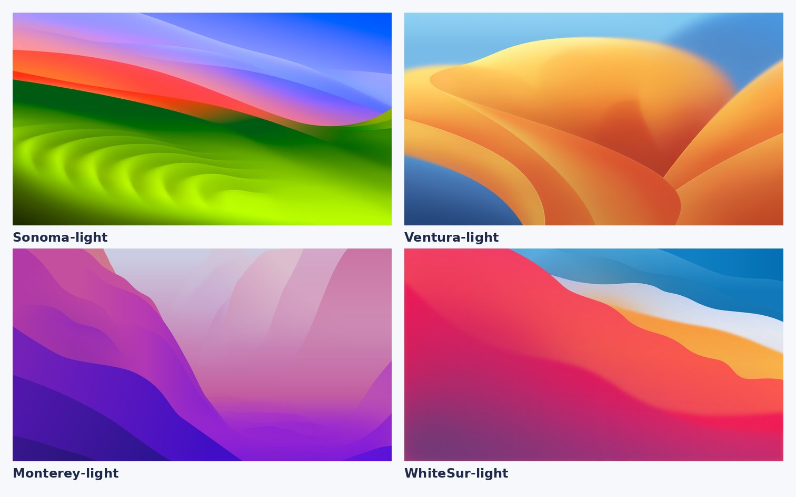
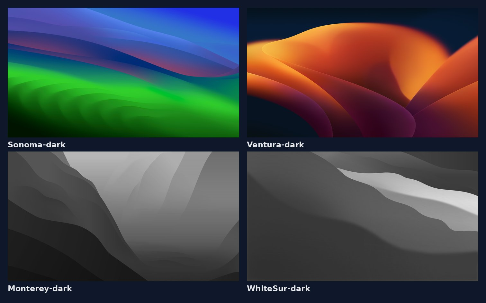
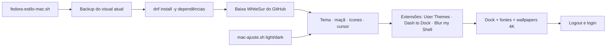

<p align="center">

</p>

<h1 align="center">Fedora Estilo Mac</h1>
<p align="center"><i>Script que deixa o Fedora (GNOME) com visual de macOS, em modo claro ou escuro, com um único comando</i></p>

<p align="center">


</p>

## Sumário

- [Sobre](#sobre)
- [O que o script faz](#o-que-o-script-faz)
- [Modos claro e escuro](#modos-claro-e-escuro)
- [Como funciona](#como-funciona)
- [Como executar](#como-executar)
- [Personalização](#personalização)
- [Como voltar ao visual anterior](#como-voltar-ao-visual-anterior)
- [Estrutura do repositório](#estrutura-do-repositório)
- [Projetos irmãos](#projetos-irmãos)
- [Créditos](#créditos)
- [Autor](#autor)

## Sobre

Automação em **Bash** para transformar o Fedora com GNOME em um desktop com cara de macOS, sem configurar nada na mão. O script baixa tudo dos projetos originais, instala com `-y` e faz backup do visual atual antes de qualquer mudança.

Feito para **Fedora Workstation 41 ou superior** com GNOME.

## O que o script faz

| Recurso | Na prática | Ferramenta |
| --- | --- | --- |
| 🎨 Tema | Janelas, barra superior, ícones e cursor no estilo macOS (inclui apps GTK4/libadwaita e Flatpak) | WhiteSur |
| 🍎 Maçã na barra | Troca o botão Atividades pela maçã (preta no claro, branca no escuro) | WhiteSur + User Themes |
| 🚀 Dock | Dock inferior centralizado, translúcido, com ocultação inteligente e apps fixados | Dash to Dock |
| 🫧 Transparência | Desfoque na barra superior e na visão geral | Blur my Shell |
| 🪟 Janelas | Botões fechar, minimizar e maximizar à esquerda | GNOME |
| 🔤 Fonte | Inter em toda a interface | rsms-inter-fonts |
| 🖼️ Papéis de parede | Coleção 4K (Sonoma, Ventura, Monterey e Big Sur), um para o claro e outro para o escuro | WhiteSur Wallpapers |
| 🔍 Spotlight | Busca nativa do GNOME com a tecla `Super` | GNOME |

## Modos claro e escuro

| | Claro (`light`) | Escuro (`dark`) |
| --- | --- | --- |
| Tema | WhiteSur-Light | WhiteSur-Dark |
| Barra superior | Clara | Preta |
| Maçã na barra | Preta | Branca |
| Papel de parede padrão | Sonoma-light (4K) | Sonoma-dark (4K) |

O GNOME guarda um papel de parede para cada modo: ao alternar entre claro e escuro, ele troca sozinho.

**Papéis de parede claros**



**Papéis de parede escuros**



## Como funciona



## Como executar

```bash
git clone https://github.com/sauloprado/fedora-estilo-mac.git
cd fedora-estilo-mac
chmod +x *.sh

# instalação completa (modo claro, padrão)
./fedora-estilo-mac.sh

# instalação completa no modo escuro
./fedora-estilo-mac.sh dark
```

Ao terminar, **faça logout e login**: no Wayland, o GNOME só carrega o tema da barra e as extensões novas depois de entrar de novo.

Depois de instalado, para **alternar entre claro e escuro** (aplica na hora):

```bash
./mac-ajuste.sh light   # barra clara, maçã preta, wallpaper claro
./mac-ajuste.sh dark    # barra preta, maçã branca, wallpaper escuro
```

> Rode como seu usuário normal, **sem `sudo`**: o script pede a senha só quando precisa instalar pacotes.

## Personalização

As variáveis ficam no topo do `fedora-estilo-mac.sh`:

| Variável | Padrão | Opções |
| --- | --- | --- |
| `PAPEL_LIGHT` | `Sonoma-light` | `Ventura-light`, `Monterey-light`, `WhiteSur-light` |
| `PAPEL_DARK` | `Sonoma-dark` | `Ventura-dark`, `Monterey-dark`, `WhiteSur-dark` |
| `TAMANHO_ICONES_DOCK` | `48` | tamanho em pixels |

Todos os papéis de parede ficam em `~/Imagens/Wallpapers-Mac` (ou `~/Pictures/Wallpapers-Mac`). Para ajustes finos, use o app **Ajustes** (GNOME Tweaks) e o **Extensões**, que o script já instala.

## Como voltar ao visual anterior

```bash
dconf load /org/gnome/ < ~/mac-look-backup/gnome.dconf
```

Depois, faça logout e login.

## Estrutura do repositório

```text
fedora-estilo-mac/
├── fedora-estilo-mac.sh   # instalação completa (light | dark)
├── mac-ajuste.sh          # alterna entre claro e escuro
├── assets/
│   ├── capa.png
│   ├── wallpapers-light.jpg
│   └── wallpapers-dark.jpg
├── LICENSE
└── README.md
```

## Projetos irmãos

| Projeto | Distribuição | Desktop |
| --- | --- | --- |
| [mint-estilo-mac](https://github.com/sauloprado/mint-estilo-mac) | Linux Mint | Cinnamon |
| [ubuntu-estilo-mac](https://github.com/sauloprado/ubuntu-estilo-mac) | Ubuntu | GNOME |
| [fedora-estilo-mac](https://github.com/sauloprado/fedora-estilo-mac) | Fedora | GNOME |

## Créditos

Temas, ícones, cursor e papéis de parede são do projeto **WhiteSur**, de [vinceliuice](https://github.com/vinceliuice), e são baixados direto da fonte original durante a execução (nada disso é redistribuído aqui). Extensões: [Dash to Dock](https://micheleg.github.io/dash-to-dock/), [Blur my Shell](https://github.com/aunetx/blur-my-shell) e User Themes (GNOME).

Projeto pessoal, sem vínculo com a Apple. macOS e o logotipo da maçã são marcas da Apple Inc.

## Autor

**Saulo Prado** · Analista de Sistemas · Gestão de Ativos de TI, orçamento, automação e dashboards

[](https://www.linkedin.com/in/saulo-prado-ab4a0b96/)
[](https://github.com/sauloprado)
